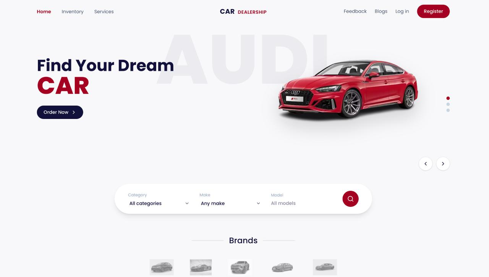
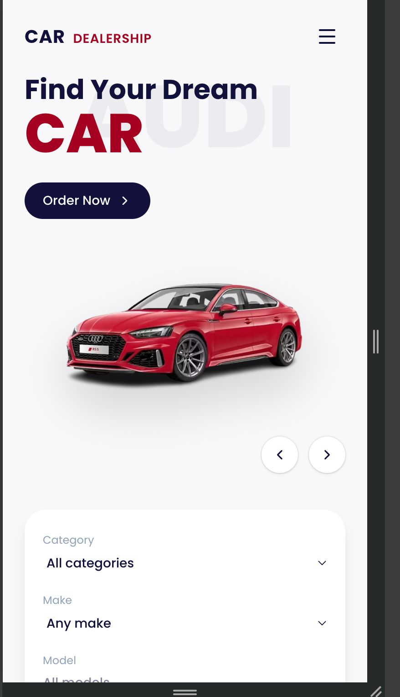
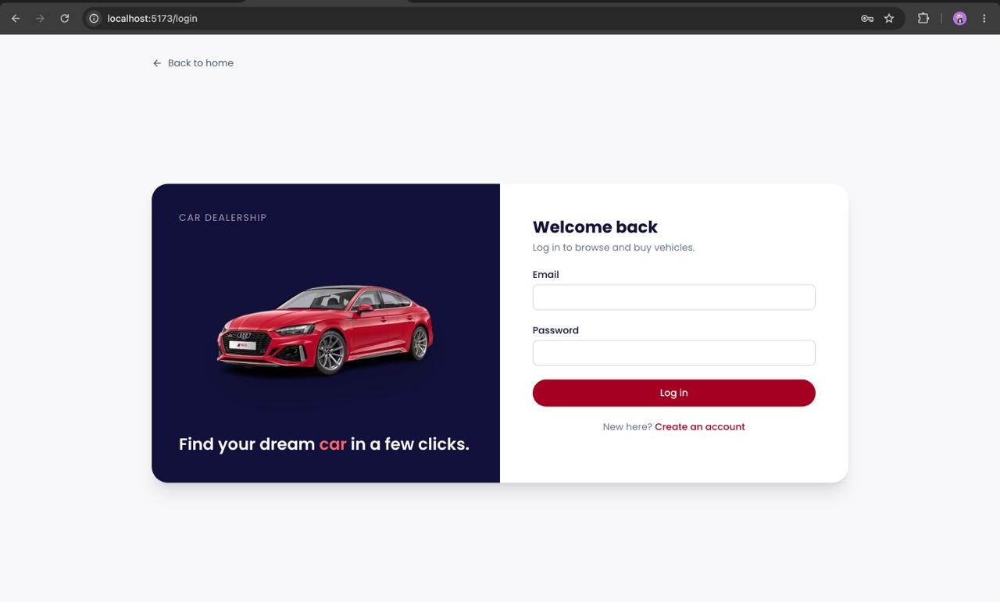
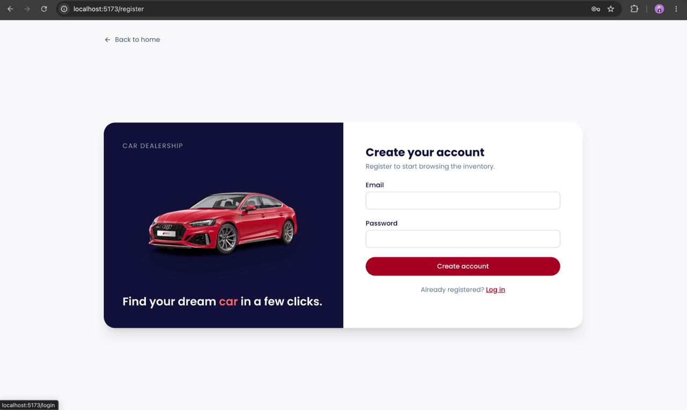
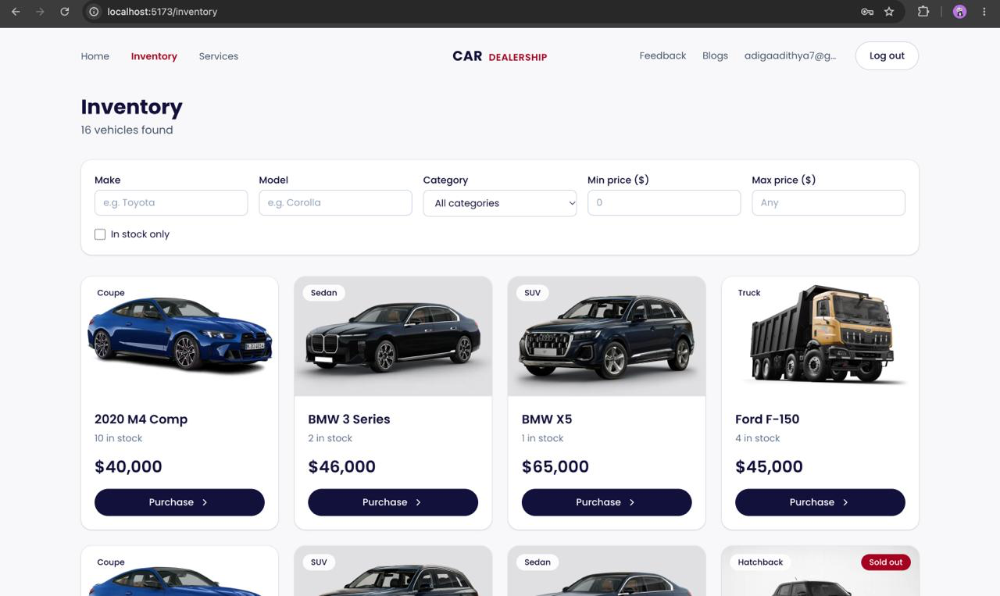
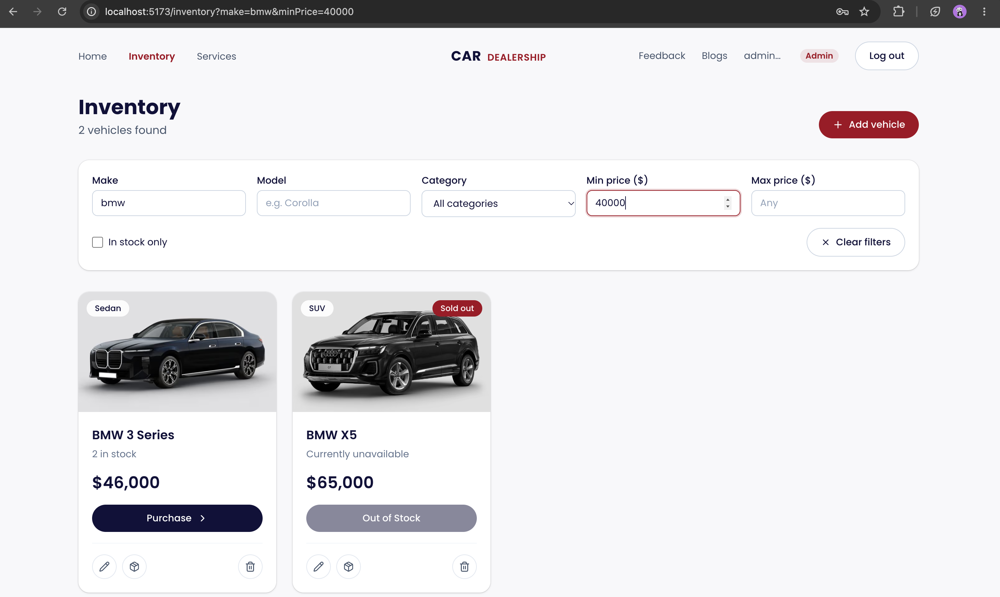
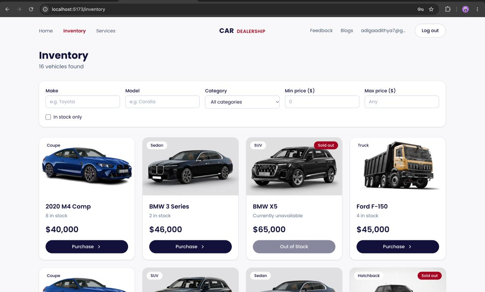
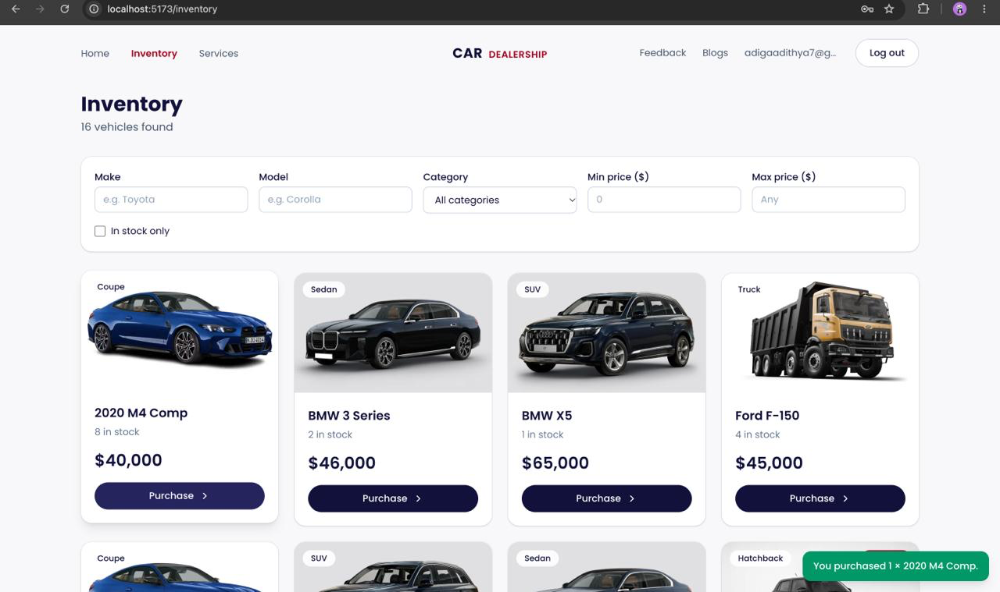
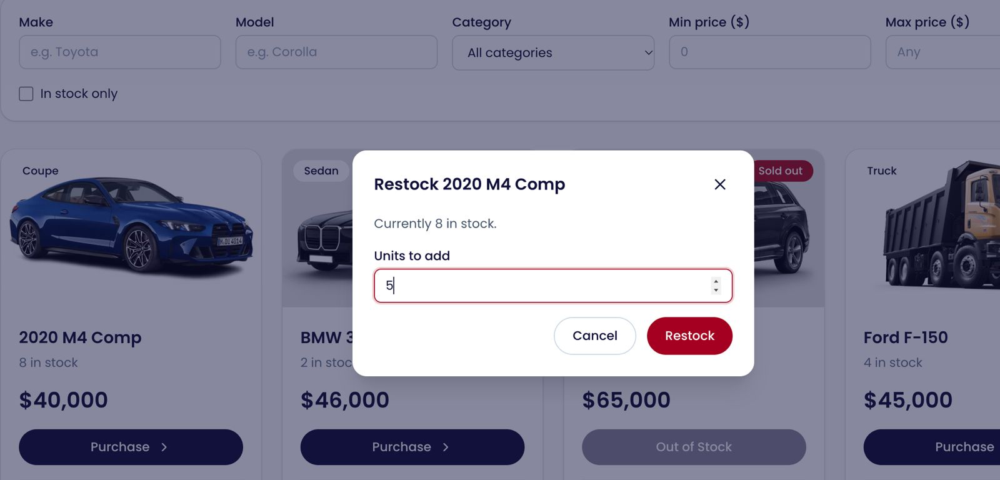
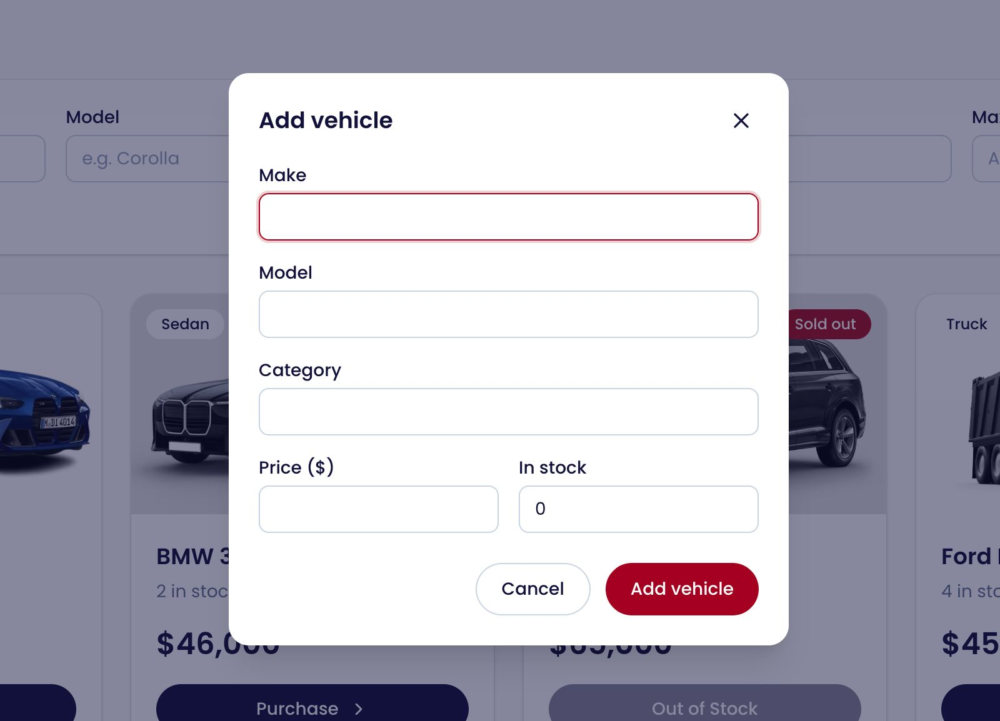

# Car Dealership Inventory System (Carzy)


A full-stack inventory application for a car dealership. Customers register, browse and search vehicles and purchase them; admins also add, edit, restock and delete vehicles. The backend is a TDD-built REST API with JWT authentication, role-based access and concurrency-safe stock updates. The frontend is a responsive React + Tailwind SPA based on a Figma design.

**Live demo:** https://carzy-dealer.vercel.app/
**API health:** https://car-dealership-inventory-y960.onrender.com/api/health
**Demo logins:** `admin@dealership.test` / `Admin123!` (admin) · or register a normal user




## Table of contents
1. [Features](#features)
2. [Tech stack](#tech-stack)
3. [Architecture](#architecture)
4. [Getting started](#getting-started)
5. [API reference](#api-reference)
6. [Design decisions](#design-decisions)
7. [Testing and TDD](#testing-and-tdd)
8. [Test report](#test-report)
9. [Screenshots](#screenshots)
10. [Deployment](#deployment)
11. [My AI Usage](#my-ai-usage)

## Features

- Register and log in with JWT authentication; passwords are hashed with bcrypt
- Two roles: `USER` can browse, search and purchase; `ADMIN` can also add, edit, restock and delete
- Search by make, model, category and price range (case-insensitive, partial match)
- The Purchase button is disabled at zero stock; stock updates are atomic, so concurrent buyers cannot oversell
- Search filters live in the URL (shareable, survive refresh), with debounced input and pagination
- Loading skeletons, empty states, error banners with retry, toasts
- Responsive, keyboard-accessible UI built from a Figma landing-page design

## Tech stack

| Layer | Technology |
|---|---|
| Backend | Node.js, TypeScript, Express 5, Prisma 6, SQLite (file-based), Zod, bcrypt, jsonwebtoken |
| Backend tests | Jest, ts-jest, Supertest |
| Frontend | React, TypeScript, Vite, Tailwind CSS v4, React Router, Axios, lucide-react |
| Frontend tests | Vitest, Testing Library, MSW |
| Production (optional) | Vercel (frontend), Render (API), Neon Postgres (database) |


## Architecture

```text
Request → Router → [authenticate → requireRole] → Controller → Service → Repository → Prisma → Database
```

- **Controllers** handle HTTP only: parse and validate input (Zod), shape responses.
- **Services** hold business rules (out-of-stock handling, login errors, 404s).
- **Repositories** are the only layer that talks to Prisma.
- **Middleware** handles authentication (JWT) and authorization (role guard).
- A central **error handler** returns `{ "error": { "code", "message", "details?" } }` for every failure.
- `app.ts` builds the Express app and `server.ts` starts listening, so Supertest can import the app without opening a port.

Frontend: React Router pages, an `AuthContext` (session in localStorage with safe wrappers), an Axios client that attaches the token and logs the user out on a 401, and URL-driven search state.

## Getting started

**Prerequisites:** Node.js 20.19+ and npm.

### 1. Backend

```bash
cd backend
cp .env.example .env
npm install
npx prisma migrate dev     
npm run seed               # admin user + 15 sample vehicles
npm run dev                
```

### 2. Frontend

```bash
cd frontend
cp .env.example .env       
npm install
npm run dev                
```

### 3. Run the tests

```bash
cd backend && npm test
cd frontend && npm test
# with coverage
cd backend && npm run test:coverage
cd frontend && npm run test:coverage
```

### Environment variables

| Variable | Where | Purpose |
|---|---|---|
| `DATABASE_URL` | backend | Database connection (SQLite file locally) |
| `JWT_SECRET` | backend | Token signing key (**use a long random value in production**) |
| `JWT_EXPIRES_IN` | backend | Token lifetime, e.g. `1h` |
| `PORT` | backend | Server port (default 4000) |
| `CORS_ORIGIN` | backend | Allowed frontend origin |
| `ADMIN_EMAIL`, `ADMIN_PASSWORD` | backend | Credentials created by `npm run seed` (demo only) |
| `VITE_API_URL` | frontend | Base URL of the API |

## API reference

All `/api/vehicles` endpoints require `Authorization: Bearer <token>`.

| Method | Endpoint | Access | Description |
|---|---|---|---|
| GET | `/api/health` | Public | Liveness check |
| POST | `/api/auth/register` | Public | Create a `USER` account |
| POST | `/api/auth/login` | Public | Returns `{ token, user }` |
| GET | `/api/vehicles` | Any user | Paginated list; in-stock only unless `includeOutOfStock=true` |
| GET | `/api/vehicles/search` | Any user | Filters: `make`, `model`, `category`, `minPrice`, `maxPrice` (cents), plus `page`, `limit`, `includeOutOfStock` |
| POST | `/api/vehicles` | Admin | Create a vehicle |
| PUT | `/api/vehicles/:id` | Admin | Partial update |
| DELETE | `/api/vehicles/:id` | Admin | Delete (204) |
| POST | `/api/vehicles/:id/purchase` | Any user | Body `{ quantity? }` (default 1); 409 `OUT_OF_STOCK` if insufficient |
| POST | `/api/vehicles/:id/restock` | Admin | Body `{ quantity }` |

A vehicle has: `id`, `make`, `model`, `category`, `price` (integer cents), `quantity`, `createdAt`, `updatedAt`.


## Design decisions

The brief left several points open. These are my decisions.

| Question | Decision | Reason |
|---|---|---|
| Who can create and update vehicles? | Admin only | The frontend section gives add/update forms to admins. Removing `adminOnly` from two routes gives the literal reading. |
| What does "available" mean? | `quantity > 0` by default; `includeOutOfStock=true` shows all | The UI needs sold-out cars to render a disabled Purchase button. |
| How are admins created? | Seed script or direct DB change; registration always creates `USER` | Prevents self-promotion. Covered by a test. |
| Price storage | Integer cents | Avoids floating-point errors. |
| Purchase concurrency | One conditional `UPDATE ... WHERE quantity >= n` | Prevents overselling. Covered by a concurrency test. |
| Out-of-stock status code | `409 Conflict` | It is a state conflict, not malformed input. |
| Login errors | Identical for unknown email and wrong password | Prevents user enumeration. |
| Role in JWT | Read from the token | Role changes apply after token expiry (trade-off for stateless auth). |
| UI "New/Used" filter from the Figma | Replaced with Category | The data model has no condition field. |
| Vehicle photos | Chosen by category | The model has no image field. |
| Landing-page car carousel | Demo cars when logged out, live data when logged in | `GET /vehicles` is protected by the spec. |
| Newsletter, blogs, testimonials | Static, front-end only | In the design but outside the spec. |

## Testing and TDD

Backend features were built red → green → refactor. The history shows it:

```bash
git log --oneline --reverse
```

Highlights (TODO: replace with your real short hashes from `git log`):

- `TODO_HASH test: add failing tests for user registration (red)` → `TODO_HASH feat: implement user registration (green)`
- `TODO_HASH refactor: extract password hashing, token signing and roles from AuthService`
- **The race condition:** the first purchase implementation read stock and then wrote it. A concurrency test (5 parallel buyers, stock of 3) was committed failing (`TODO_HASH`), and the fix (`TODO_HASH`) made the decrement a single conditional `UPDATE`.
- Frontend: red → green pairs for price formatting, the auth form, the protected route and the vehicle card.

Backend tests cover auth, JWT middleware, role guards (401 vs 403), vehicle CRUD, search, purchase, restock and concurrency. Frontend tests cover the logic-heavy parts: formatting helpers, the login/register form, route protection, and the vehicle card (Purchase disabled at zero stock, admin controls hidden from users).

## Test report

| Suite | Test files | Tests | Result | Statements | Branches | Functions | Lines |
|---|---|---|---|---|---|---|---|
| Backend (Jest + Supertest) | 11 | 85 | ✅ all passing | 96.89% | 81.69% | 98.33% | 97.93% |
| Frontend (Vitest + Testing Library) | 4 | 13 | ✅ all passing | 24.28% | 28.50% | 16.66% | 26.38% |

Raw output: [`docs/backend-test-output.txt`](docs/backend-test-output.txt) · [`docs/frontend-test-output.txt`](docs/frontend-test-output.txt)

### Backend

All 11 suites (85 tests) pass in about 79 s. The coverage gate configured in `jest.config.js` (85% statements, 75% branches, 85% functions, 85% lines) is met. Every service, controller, route, schema and repository file is at or near 100% for lines; the few uncovered lines are defensive branches, such as unexpected-error paths in `errorHandler.ts` and `token.ts`.

| Area | Statements | Branches | Lines |
|---|---|---|---|
| Middleware (`authenticate`, `requireRole`, `errorHandler`) | 92.68% | 87.50% | 94.44% |
| Auth module | 95.83% | 90.90% | 95.74% |
| Vehicles module | 99.00% | 95.45% | 100% |
| Shared lib (`password`, `token`, `objectId`, `prisma`) | 96.00% | 70.00% | 95.23% |

### Frontend

The frontend tests target the logic-heavy parts, and those are well covered:

| File | Statements | Branches | Lines |
|---|---|---|---|
| `routes/ProtectedRoute.tsx` | 100% | 100% | 100% |
| `components/vehicles/VehicleCard.tsx` | 100% | 100% | 100% |
| `components/auth/AuthForm.tsx` | 92.59% | 88.46% | 95.83% |
| `context/AuthContext.tsx` | 79.16% | 75.00% | 80.95% |
| `lib/format.ts` | 87.50% | 100% | 100% |

The overall frontend figure (24.28% statements) is low because most files are not unit-tested: the landing-page sections (`components/home`, `components/layout`, `pages`), which are presentational and checked manually against the Figma design, and also the data hooks, API modules, search filters and admin forms (`SearchFilters`, `VehicleForm`, `RestockDialog`, `useVehicles`, `searchParams`). Those untested parts were verified through manual testing in the browser. Adding tests for `paramsFromUrl`, `useVehicles` and the admin forms is the first item in future work.

Reproduce with:

```bash
cd backend && npm run test:coverage
cd frontend && npm run test:coverage
```

## Screenshots

| | |
|---|---|
|  Landing page |  Landing page (mobile) |
|  Login |  Register |
|  Inventory (user) |  Filtered search |
|  Out-of-stock card |  Purchase confirmation |
|  Admin controls |  Add vehicle form |

## Deployment

*(Delete this section if you did not deploy.)*

| Part | Platform | Notes |
|---|---|---|
| Frontend | Vercel | Root dir `frontend`, env `VITE_API_URL`, SPA rewrite in `vercel.json` |
| Backend | Render | Root dir `backend`; build runs `prisma migrate deploy` against Postgres |
| Database | Neon (Postgres) | Direct connection string in `DATABASE_URL` |

Local development and tests use SQLite; production uses Postgres because free hosts have ephemeral disks. Prisma migrations are provider-specific, so Postgres has its own `prisma-pg/` schema and migrations, and a `textFilter` helper adds case-insensitive matching on Postgres. Schema changes must be applied to both `prisma/` and `prisma-pg/`.

## My AI Usage

### Tools used

- **Claude (Anthropic)** via claude.ai, across six chat sessions (see `PROMPTS.md`), for planning, scaffolding, generating code and tests, and drafting documentation.

### How I used them

| Area | How AI helped | What I did myself |
|---|---|---|
| Understanding the brief (Session 1) | Summarised the assessment's requirements and process rules | Set the stack (Node, TypeScript, Express 5, Prisma 6, MongoDB, Jest, Supertest, React, Vite, Tailwind v4, Vitest) and the working rules: full files, commands and commits for every step, red commit before green, conventional commits with a `Co-authored-by` trailer |
| Backend scaffolding (Session 2) | Drafted the project setup, folder layout and Prisma schema | Specified the models (User with unique email and default role USER; Vehicle with price in cents), required `app.ts` and `server.ts` to be separate, and asked for the health check to be built test-first. TODO: how I ran and debugged the setup |
| Backend features (Session 3) | Drafted the red/green/refactor test plan and the atomic purchase update | Specified the security rules (no self-registration as admin, identical login errors for wrong password and unknown email), the admin-only routes, the layered architecture, the seed script and the ~85% coverage threshold. TODO: which tests I wrote or changed myself |
| Concurrency (Session 3) | Showed the atomic conditional `updateMany` pattern | Asked for the naive version first, then a failing concurrency test, then the fix. TODO: confirm I reproduced the failure and can explain why the fix works |
| Frontend (Session 4) | Proposed the structure, build order and test list | Supplied my own Figma screenshots (`Component.png`, `Home.png`) and asked for the landing page to match; specified the pages, URL-synced debounced filters, pagination and test-first components. TODO: what I changed after comparing with Figma |
| Documentation (Session 5) | Outlined the README and `PROMPTS.md` structure | Told it not to invent numbers, commit hashes or stories, and to use TODO for missing facts; I paste real coverage output and git log myself |
| Deployment (Session 6) | Gave a short outline (Vercel, Railway, `VITE_API_URL`, CORS) | TODO: what I actually did to deploy, or state that I did not |

### Where AI was wrong or needed correction

Two mismatches are visible in the logged responses. Confirm whether I hit them and fill in what I did:

- **Database setup (Session 2).** The suggested test setup used `DATABASE_URL=file:./test.db` (a SQLite-style URL) and the schema used `@default(uuid())` ids, but the project uses MongoDB. TODO: what happened and how I fixed it (e.g. ObjectId ids, a real MongoDB test database).
- **Migrations (Session 5).** The setup steps suggested `npx prisma migrate dev`, which does not apply to Prisma with MongoDB (`prisma db push` is used instead). TODO: confirm whether I noticed and what I put in the README.
- TODO: add any other real problems (symptom, cause, my fix). If nothing else went wrong, say so honestly.

### How I verified AI output


- Ran the test suite after every change, and confirmed red tests failed before implementing
- Read the generated code and can explain the main flows
- Tested manually in the browser and with curl, including 403 checks as a normal user
- Compared the UI against the Figma design